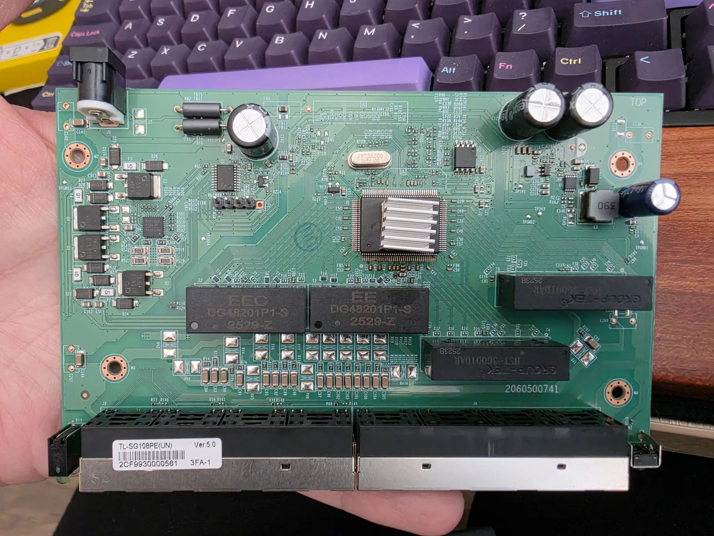

### 2060500741

## Brands
|Brand|Type|Managed|PCB|Flash|Chip RTL|
|---|---|---|---|---|---|
| TP-Link | TL-SG108PE V5 | Yes | 2060500741 | 2M (cFeon/ESMT EN25QH16B) | RTL8370N |

### Label specifications

- **Model**: TL-SG108PE(UN) Ver:5.0
- **Ports**:
  - 8 × RJ45: 10/100/1000 Mbps, PoE on ports 1-4
- **Power**: external DC adapter

## PCB

PCB silkscreen: 2060500741



- The switch chip, an RTL8370N, sits under the heatsink.
- U3 is the SPI flash, a cFeon/ESMT EN25QH16B (2 MiB).
- U4 is an MPS MP3924 PoE controller. U5, a Cmsemicon CMS8S5880 8051 microcontroller, sits next to it.
- J2, the five-pin header next to U5, is not a console for the switch chip. No UART pads for the switch chip were found.
- GPIO 1, 5, 8 and 9 of the switch chip enable PoE on ports 1-4 (high is on).

The board, flash layout and stock firmware are described in [tl-sg108pe-v5-firmware.md](../tl-sg108pe-v5-firmware.md).

### Building

```
make MACHINE=TPLINK_TL_SG108PE_V5 RTL8370_DUMP=<2 MiB flash dump of this board>
```

The GPHY patch is Realtek data that the build extracts from the board's own flash dump. Without `RTL8370_DUMP`, the image runs the GPHYs without the patch.

### Installation

- From the stock firmware: build the OEM upgrade image with `make MACHINE=TPLINK_TL_SG108PE_V5` in `installer/` and upload it through the TP-Link web interface; see the README. This was tested with TP-Link firmware 1.0.1 Build 20260330.
- With a SOIC-8 clip: write the image to U3 at 3.3 V with the switch unpowered. Keep a dump of the original flash first.

### Status

Two units run RTLPlayground as their only firmware. The RTL836x sections of [stp.md](../stp.md) and [lacp.md](../lacp.md) list what is limited or untested on this chip.
